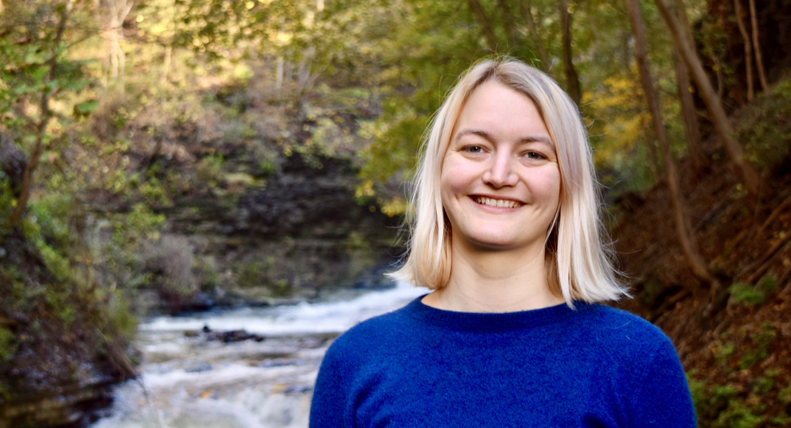

## About

I am a fifth-year PhD candidate in the [Department of Computer Science][cornellcs] at Cornell University and an [NSF GRFP fellow][grfp]. 
I work with [Adrian Sampson][adrian] in the [Computer Architecture and Programming Abstractions][capra] research group. My research interests span [programming languages][pl] and systems, with a special affinity for applied formal methods. 
I like systems that use solver-aided reasoning to make is easier for developers to trust their low-level code.
I work on [Diospyros][], a compiler that uses equality saturation to find vectorization for energy-efficient hardware, and the [Kani Rust Verifier][kani], a bit-precise verifier for sequential Rust code. 

Recently, I have been contributing to verification efforts for [ISLE][], a term-rewriting language for instruction lowering within [Cranelift][] (a native code generator for [Wasmtime][] and an alternative backend for Rust).

I completed my bachelor’s at [Brown][browncs], where I worked on some projects using [modeling tools][mstalloy] and [refinement types][rtypes]. 
I spent two years at Apple engineering [health software][apple] for the iPhone and Apple Watch.

[My CV.](vanhattum_cv.pdf)

[cornellcs]: http://www.cs.cornell.edu
[grfp]: https://www.nsfgrfp.org
[adrian]: https://www.cs.cornell.edu/~asampson/
[capra]: https://capra.cs.cornell.edu
[pl]: http://pl.cs.cornell.edu
[diospyros]: https://github.com/cucapra/diospyros
[kani]: https://github.com/model-checking/kani
[isle]: https://github.com/bytecodealliance/wasmtime/blob/main/cranelift/isle/docs/language-reference.md
[cranelift]: https://bytecodealliance.org/articles/cranelift-progress-2021
[wasmtime]: https://github.com/bytecodealliance/wasmtime
[browncs]: http://cs.brown.edu
[mstalloy]: https://github.com/avanhatt/minimum-spanning-trees-alloy
[rtypes]: https://cs.brown.edu/research/pubs/theses/capstones/2016/van.hattum.alexa.pdf
[apple]: https://www.apple.com/apple-watch-series-4/health/

## News
- I'll teach [CS2110: Object-Oriented Programming and Data Structures][2110] this summer. [April 2022]
- I will serve on the program committee of the [EGRAPHS workshop][egraphs]. [March 2022]
- Our paper on verifying dynamic trait objects in Rust was accepted to [ICSE SEIP][icseseip]! [January 2022]
- I gave a guest lecture on [Diospyros][dios] to Wellesley's [Principals of Programming][wellesley] course. [December 2021]
- I passed my A exam (admission to candidacy/thesis proposal)! [December 2021] 
- I interned with the AWS Automated Reasoning Group, working on improving dynamic dispatch support within the [Kani Rust Verifier][kani]. [June 2021]
- I gave a guest lecture on [Diospyros][dios] at Brown's [Logic for Systems][lfs] seminar. [April 2021]
- I had a blast presenting our work on [Diospyros][dios] at [UCSC's Languages, Systems, and Data seminar][ucsclsd]. [December 2020]
- Our full-length paper on [Diospyros][dios] was accepted to [ASPLOS 2021][asplos]! [November 2020]
- I presented our work-in-progress short paper on [Diospyros][dios] at [LCTES 2020][lctes]. [June 2020]
- [Rachit Nigam][rachit] and I are finalists for [Qualcomm's Innovation Fellowship][qinf]. [April 2020]
- I was fortunate to be awarded the [NSF's GRFP fellowship][grfp]. [March 2020]
- Honored to have my work as a Head TA mentioned in the acknowledgments of Professor [Andy van Dam][avd]’s [Reflections on an introductory CS course, CS15, at Brown University][cs15] in ACM Inroads. [November 2018]

<!-- - I was a student volunteer at [PLDI][] at [FCRC][] in Phoenix. [June 2019] -->
<!-- - I attended [SNAPL][] in Providence, RI. [May 2019] -->
<!-- - I participated in the [CRA-W Grad Cohort Workshop for Women][craw]. [April 2019]  -->

[2110]: https://classes.cornell.edu/browse/roster/SU22/class/CS/2110
[egraphs]: https://pldi22.sigplan.org/home/egraphs-2022
[icseseip]: https://conf.researchr.org/track/icse-2022/icse-2022-seip---software-engineering-in-practice
[wellesley]: https://cs.wellesley.edu/~cs251/f21/
[lfs]: http://cs.brown.edu/courses/csci1710/
[dios]: https://github.com/cucapra/diospyros
[ucsclsd]: https://lsd.ucsc.edu/lsd-seminar/2020fa/
[asplos]: https://asplos-conference.org/
[lctes]: https://conf.researchr.org/home/LCTES-2020
[dios-video]: https://youtu.be/fDnsmRY7LOc
[rachit]: https://rachitnigam.com
[qinf]: https://www.qualcomm.com/invention/research/university-relations/innovation-fellowship/2020-north-america
[grfp]: https://www.nsfgrfp.org
[pldi]: https://pldi19.sigplan.org
[fcrc]: https://fcrc.acm.org
[snapl]: https://snapl.org/2019/
[craw]: https://cra.org/cra-w/events/grad-cohort-2019/
[avd]: http://cs.brown.edu/people/avandam/
[cs15]: https://dl.acm.org/citation.cfm?id=3284639

## Publications

### Conference Papers
- "Verifying Dynamic Trait Objects in Rust" Alexa VanHattum, Daniel Schwartz-Narbonne, Nathan Chong, and Adrian Sampson. To appear in [ICSE Software Engineering in Practice 2022][icseseip]. ([preprint][dyn-trait-icse-preprint]).

- ["Vectorization for Digital Signal Processors via Equality Saturation"][dios-asplos-dl] Alexa VanHattum, Rachit Nigam, Vincent T. Lee, James Bornholt, Adrian Sampson. In [ASPLOS 2021][asplos]. ([local pdf][dios-asplos-preprint], [5 minute talk video][dios-5m], [17 minute talk video][dios-17m])

### Short Papers
- ["A Synthesis-aided Compiler for DSP Architectures (WiP Paper)."][dios-lctes-dl] Alexa VanHattum\*, Rachit Nigam\*, Vincent T. Lee, James Bornholt, Adrian Sampson (\*equal contribution). In [LCTES 2020][lctes]. ([local pdf][lctes-preprint], [talk video][dios-video]).

[dyn-trait-icse-preprint]: dyn-trait-icse-seip-2022-preprint.pdf

[dios-asplos-dl]: https://dl.acm.org/doi/10.1145/3445814.3446707
[dios-asplos-preprint]: diospyros-asplos-2021-preprint.pdf
[dios-5m]:https://www.youtube.com/watch?v=pGHjvPLrmRc
[dios-17m]:https://www.youtube.com/watch?v=RvMI4prTqHY&feature=youtu.be

[dios-lctes-dl]: https://dl.acm.org/doi/abs/10.1145/3372799.3394358
[lctes-preprint]: diospyros-lctes-2020.pdf
[dios-video]: https://youtu.be/fDnsmRY7LOc
[lctes]: https://conf.researchr.org/home/LCTES-2020

## Recorded Talks
- [Vectorization for Digital Signal Processors via Equality Saturation][dios-asplos-dl]. [ASPLOS 2021][asplos]. [5 minute talk video][dios-5m], [17 minute talk video][dios-17m].
- [A Synthesis-aided Compiler for DSP Architectures (WiP Paper)][dios-video] for [LCTES 2020][lctes] [June 2020]
- [What's New in Health](https://developer.apple.com/videos/play/wwdc2017/221/) [(slides)](https://devstreaming-cdn.apple.com/videos/wwdc/2017/221izy8b17y2dtiy/221/221_whats_new_in_health.pdf?dl=1) at Apple's World Wide Developers Conference [Spring 2017]

[dios-video]: https://youtu.be/fDnsmRY7LOc
[lctes]: https://conf.researchr.org/home/LCTES-2020

## Teaching

Cornell University
- Instructor for [CS2110: Object-Oriented Programming and Data Structures][2110] [Summer 2022]
- Grad TA (part-time) for [CS 4110: Programming Languages & Logics](http://www.cs.cornell.edu/courses/cs4110/2020fa/) [Fall 2020]
- Grad TA for [CS 4110: Programming Languages & Logics](http://www.cs.cornell.edu/courses/cs4110/2018fa/) [Fall 2018]

Brown University
- Head TA for [CS 195y: Logic for Systems](http://cs.brown.edu/courses/cs195y/2016/) [Spring 2016]
- Head TA for [CS 15: Intro. Object-Oriented Programming & Computer Science](https://cs.brown.edu/courses/cs015/) [Fall 2015]
- TA for [CS 22: Discrete Math & Probability](https://cs.brown.edu/courses/csci0220/) [Spring 2015]
- TA for [CS 15: Intro. Object-Oriented Programming & Computer Science](https://cs.brown.edu/courses/cs015/) [Fall 2014]
- TA for [CS 8: First Byte of Computer Science](http://cs.brown.edu/courses/cs008/2017/) [Spring 2014]

## Service
- I am on the program committee for the [2022 EGRAPHS workshop][egraphs] at PLDI.
- I am on the executive board for [Graduate Students for Gender Inclusion in Computing][gsgic] at Cornell.
- I co-organized Cornell's Programming Languages Discussion Group [(PLDG)][pldg] from Aug 2020-Dec 2021.
- I was on the [OOPSLA 2020 Artifact Evaluation Committee][oopsla20aec].
- I was on the CS department's 2020 Fall Teaching Committee.
- I helped organize the CS department's [colloquium talks][colloq].
- I co-organized Cornell's [2019 Admitted PhD Student Visit Day][visit].
- I volunteered at Cornell's 2019 [Girls' Adventures In Math][gam].

[oopsla20aec]: https://2020.splashcon.org/committee/splash-2020-Artifacts-artifact-evaluation-committee
[pldg]:https://pl.cs.cornell.edu/pldg/2020fa/
[colloq]:https://www.cs.cornell.edu/content/fall-2019-colloquium
[gsgic]:https://gsgic.org
[visit]:https://www.cs.cornell.edu/projects/phdvisit/
[gam]:https://www.girlsadventuresinmath.com/ithaca